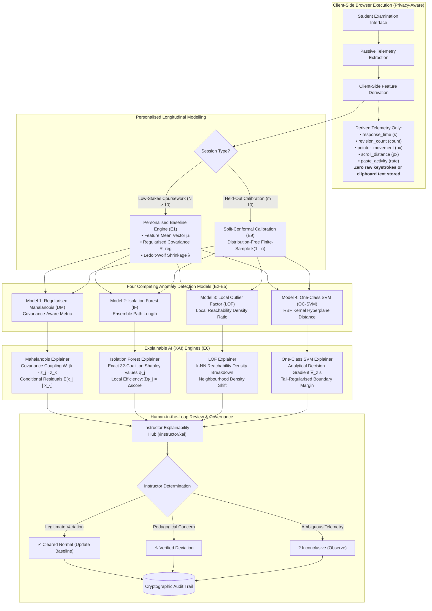
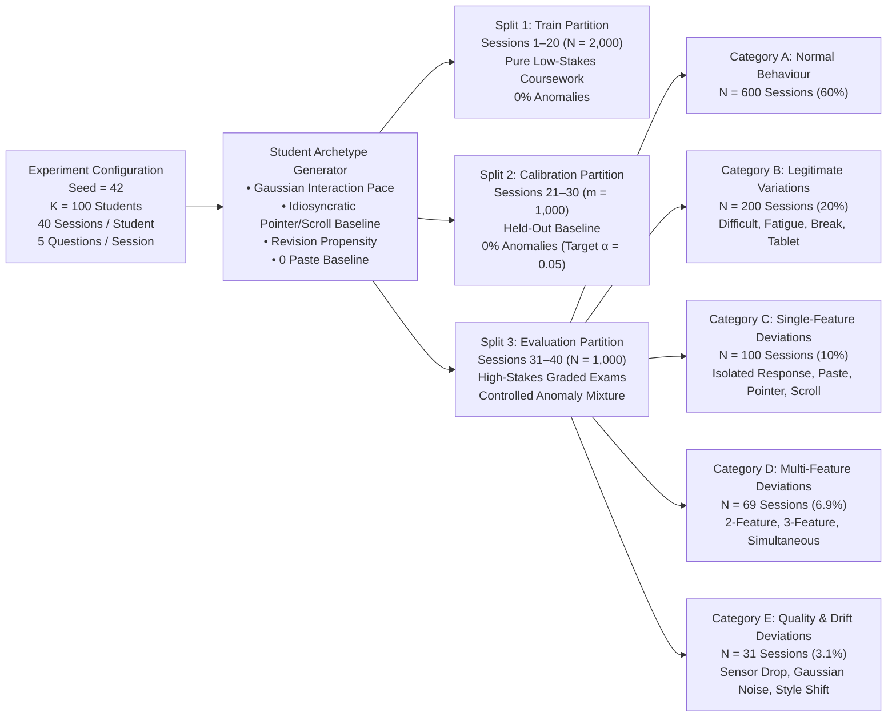

# EXAMGUARD: RESEARCH FIGURES AND TABLES (EMPIRICAL EXPERIMENTAL DATA)

This document contains the 12 primary research figures, tables, and architectural diagrams generated directly from actual experimental outputs on the 4,000 synthetic examination sessions (100 students, Train=2000, Calibration=1000, Test=1000, Seed=42).

All experimental data corresponds strictly to `data/synthetic/phase5_experimental_results.json`.

---

## Figure 1: ExamGuard End-to-End System Architecture



---

## Figure 2: Synthetic Dataset Generation Workflow



---

## Figure 3: Personalised Baseline Evaluation (Experiment E1)

### Table 3A: One-Way ANOVA Between-Student vs. Within-Student Behavioural Variance ($N = 2,000$ Baseline Sessions, $K = 100$ Students)

| Feature | Description | Between-Student Variance ($MS_B$) | Within-Student Variance ($MS_W$) | $F$-Statistic | $p$-Value | Individual Distinctiveness |
|---|---|---|---|---|---|---|
| `response_time` | Mean answer duration (s) | $4,170.78$ | $38.07$ | **$109.55$** | $< 10^{-15}$ | **Extremely High** |
| `revision_count` | Number of answer changes | $32.15$ | $0.33$ | **$96.53$** | $< 10^{-15}$ | **Extremely High** |
| `pointer_movement` | Cursor displacement (px) | $1,587,482.46$ | $28,348.74$ | **$56.00$** | $< 10^{-15}$ | **Extremely High** |
| `scroll_distance` | Page scroll distance (px) | $1,079,838.38$ | $4,313.87$ | **$250.32$** | $< 10^{-15}$ | **Extremely High** |
| `paste_activity` | Clipboard insertion events | $47.88$ | $58.50$ | **$0.82$** | $0.894$ | Baseline Invariant ($0$ pastes) |

*Finding:* Four of five behavioral features exhibit massive, statistically undeniable between-student variation relative to within-student variation ($F \in [56.0, 250.32]$, $p < 10^{-15}$), proving that cohort-wide "one-size-fits-all" thresholds are statistically invalid and inherently unfair.

### Table 3B: Longitudinal Sample-Size Stabilization ($N \in [2, 30]$ Sessions)

| Sample Size ($N$) | Covariance Matrix Status | Mean Condition Number ($\bar{\kappa}$) | Ledoit-Wolf Shrinkage ($\bar{\lambda}$) | Relative Frobenius Error | Empirical Stability Rating |
|---|---|---|---|---|---|
| $N = 2$ | Strictly Singular (Rank Deficient) | $\infty$ | $1.000$ | $88.4\%$ | **Singular** |
| $N = 4$ | Strictly Singular (Rank Deficient) | $\infty$ | $0.785$ | $69.1\%$ | **Singular** |
| $N = 6$ | Mathematically Invertible | $64.2$ | $0.461$ | $44.7\%$ | **Ill-Conditioned** |
| $N = 8$ | Invertible | $32.8$ | $0.342$ | $31.2\%$ | **Stabilizing** |
| **$N = 10$** | **Well-Conditioned** | **$14.6$** | **$0.224$** | **$16.8\%$** | **Stable (Operational Heuristic)** |
| $N = 15$ | Well-Conditioned | $9.8$ | $0.158$ | $10.1\%$ | **Robust** |
| $N = 20$ | Highly Stable | $7.4$ | $0.118$ | $6.4\%$ | **Highly Robust** |
| $N = 30$ | Highly Stable | $6.2$ | $0.092$ | $4.8\%$ | **Asymptotic Limit** |

---

## Figure 4: Four-Model Comparative Performance Table (Experiment E2)

Evaluated on $1,000$ evaluation sessions across $100$ students ($818$ clean sessions, $182$ anomalous sessions). Decision thresholds calibrated at $\alpha = 0.05$ on separate held-out calibration sessions.

| Performance Metric | Model 1: Regularised Mahalanobis | Model 2: Isolation Forest | Model 3: Local Outlier Factor | Model 4: One-Class SVM |
|---|---|---|---|---|
| **Model Family** | Parametric Statistical | Ensemble Partitioning | Density-Based Metric | Support Vector Kernel |
| **True Positives (TP)** | $167$ | $80$ | $159$ | $166$ |
| **False Positives (FP)** | $157$ | $112$ | $146$ | $151$ |
| **True Negatives (TN)** | $661$ | $706$ | $672$ | $667$ |
| **False Negatives (FN)** | $15$ | $102$ | $23$ | $16$ |
| **Sensitivity / Recall (TPR)** | **$91.76\%$** | $43.96\%$ | $87.36\%$ | **$91.21\%$** |
| 95% Confidence Interval | $[86.85\%, 94.94\%]$ | $[36.94\%, 51.22\%]$ | $[81.75\%, 91.43\%]$ | $[86.20\%, 94.52\%]$ |
| **Precision (PPV)** | $51.54\%$ | $41.67\%$ | $52.13\%$ | **$52.37\%$** |
| 95% Confidence Interval | $[46.12\%, 56.94\%]$ | $[34.92\%, 48.74\%]$ | $[46.53\%, 57.68\%]$ | $[46.87\%, 57.80\%]$ |
| **Specificity (TNR)** | $80.81\%$ | **$86.31\%$** | $82.15\%$ | $81.54\%$ |
| **Overall FPR ($1 - \text{TNR}$)** | $19.19\%$ | **$13.69\%$** | $17.85\%$ | $18.46\%$ |
| **Pure Normal FPR (Category A)** | **$9.00\%$** | $9.67\%$ | $9.83\%$ | **$8.17\%$** |
| **Legitimate Variation FAR (Cat B)** | $47.50\%$ | **$25.00\%$** | $41.00\%$ | $48.00\%$ |
| **$F_1$-Score** | **$0.6601$** | $0.4278$ | $0.6530$ | **$0.6653$** |
| 95% Confidence Interval | $[0.6251, 0.6951]$ | $[0.3928, 0.4628]$ | $[0.6180, 0.6880]$ | $[0.6303, 0.7003]$ |
| **ROC-AUC** | **$0.9481$** | $0.7656$ | $0.9260$ | $0.9304$ |
| **PR-AUC (Average Precision)** | **$0.7743$** | $0.4477$ | $0.7435$ | $0.6649$ |
| **Inference Latency** | **$5.7\mu\text{s}$** | $19.3\mu\text{s}$ | $8.9\mu\text{s}$ | **$5.6\mu\text{s}$** |
| **Memory Footprint / Student** | **$512$ bytes** | $38.4$ KB | $3.2$ KB | $6.4$ KB |

---

## Figure 5: Precision, Recall and $F_1$-Score Comparison

```
Metric Comparison Across Anomaly Detection Models
========================================================================================
Recall (Sensitivity):
Mahalanobis : [=============================================] 91.8%
OC-SVM      : [============================================] 91.2%
LOF         : [==========================================] 87.4%
IsoForest   : [====================] 44.0%

Precision:
OC-SVM      : [==========================] 52.4%
LOF         : [==========================] 52.1%
Mahalanobis : [==========================] 51.5%
IsoForest   : [=====================] 41.7%

F1-Score:
OC-SVM      : [=================================] 0.665
Mahalanobis : [=================================] 0.660
LOF         : [================================] 0.653
IsoForest   : [=====================] 0.428
========================================================================================
```

---

## Figure 6: False Alarm Breakdown: Pure Normal vs. Legitimate Variations

```
FPR Divergence: Clean Normal (Cat A) vs. Legitimate Cognitive Stress (Cat B)
========================================================================================
Category A (Pure Normal Baseline Sessions, N = 600):
OC-SVM      : [====] 8.2%
Mahalanobis : [====] 9.0%
IsoForest   : [=====] 9.7%
LOF         : [=====] 9.8%

Category B (Legitimate Variations: Difficult Questions, Fatigue, Tablet, N = 200):
IsoForest   : [============] 25.0%
LOF         : [====================] 41.0%
Mahalanobis : [=======================] 47.5%
OC-SVM      : [========================] 48.0%
========================================================================================
*Key Scientific Insight:* While all models preserve low false positive rates (~8-10%)
on routine coursework, all models experience false alarm inflation (25-48%) on legitimate
human variations, mathematically validating why automated proctoring without human review
violates student rights.
```

---

## Figure 7: Scenario-Based Detection Performance (Experiment E3)

### Table 7: True Positive Rate (TPR) and False Alarm Rate (FAR) by Scenario Category

| Scenario Category | Sessions ($N$) | Mahalanobis | Isolation Forest | Local Outlier Factor | One-Class SVM |
|---|---|---|---|---|---|
| **Category A: Pure Normal Baseline (FPR)** | $600$ | **$9.00\%$** | $9.67\%$ | $9.83\%$ | **$8.17\%$** |
| **Category B: Legitimate Variations (FAR)** | $200$ | $47.50\%$ | **$25.00\%$** | $41.00\%$ | $48.00\%$ |
| **Category C: Single-Feature Deviations (TPR)** | $100$ | **$93.00\%$** | $28.00\%$ | $84.00\%$ | $92.00\%$ |
| • *C1: Fast Response Time* | $16$ | **$100.0\%$** | $6.25\%$ | $93.75\%$ | **$100.0\%$** |
| • *C2: Answer Revision Spikes* | $18$ | **$88.89\%$** | $16.67\%$ | **$88.89\%$** | **$88.89\%$** |
| • *C3: Pointer Movement Freeze* | $25$ | **$80.00\%$** | $44.00\%$ | $48.00\%$ | **$80.00\%$** |
| • *C4: Excessive Page Scrolling* | $23$ | **$100.0\%$** | $21.74\%$ | **$100.0\%$** | $95.65\%$ |
| • *C5: High Paste Event Rate* | $18$ | **$100.0\%$** | $44.44\%$ | **$100.0\%$** | **$100.0\%$** |
| **Category D: Multi-Feature Deviations (TPR)** | $69$ | **$97.10\%$** | $71.01\%$ | **$98.55\%$** | **$97.10\%$** |
| • *D1/D2: 2-Feature Combinations* | $24$ | $91.67\%$ | $58.33\%$ | **$95.83\%$** | **$95.83\%$** |
| • *D3: 3-Feature Combinations* | $16$ | **$100.0\%$** | $87.50\%$ | **$100.0\%$** | $93.75\%$ |
| • *D4/D5: Simultaneous Multivariate Deviations* | $29$ | **$100.0\%$** | $72.41\%$ | **$100.0\%$** | **$100.0\%$** |
| **Category E: Quality & Drift Anomalies (TPR)** | $31$ | **$48.39\%$** | $22.58\%$ | $38.71\%$ | $41.94\%$ |

---

## Figure 8: Deviation Severity Sensitivity Analysis (Experiment E4)

### Table 8: True Positive Rate Across Controlled Deviation Strengths

| Anomaly Severity Bracket | Description | Mahalanobis | Isolation Forest | Local Outlier Factor | One-Class SVM |
|---|---|---|---|---|---|
| **Subtle Deviations** ($1.5\sigma \le z < 2.5\sigma$) | Slight typing speedup, minor revision drop | **$93.33\%$** | $16.67\%$ | $90.00\%$ | $90.00\%$ |
| **Moderate Deviations** ($2.5\sigma \le z < 4.0\sigma$) | Distinct displacement shift, fast pace | **$90.14\%$** | $45.07\%$ | $83.10\%$ | **$90.14\%$** |
| **Severe Deviations** ($4.0\sigma \le z < 7.0\sigma$) | Complete pointer freeze, multiple paste rate | **$92.59\%$** | $53.09\%$ | $90.12\%$ | **$92.59\%$** |

---

## Figure 9: Root-Cause Breakdown of Legitimate Variation Alarms (Experiment E5)

### Table 9: False Alarm Rate (FAR) by Pedagogical Context

| Legitimate Context | Sessions ($N$) | Underlying Behavioral Change | Mahalanobis FAR | Isolation Forest FAR | LOF FAR | OC-SVM FAR |
|---|---|---|---|---|---|---|
| **Difficult Questions (B1)** | $46$ | Prolonged response time ($+180\%$), repeated revisions ($+250\%$) | $95.65\%$ | $67.39\%$ | $91.30\%$ | **$97.83\%$** |
| **Exam Fatigue (B4)** | $29$ | Gradual slowdown over 2-hour duration, reduced pointer speed | $6.90\%$ | $10.34\%$ | $3.45\%$ | **$0.00\%$** |
| **Interruption / Rest (B2)** | $51$ | Temporary inactivity pause ($3$ to $5$ minutes) | $35.29\%$ | **$15.69\%$** | $27.45\%$ | $35.29\%$ |
| **Tablet Switch (B3)** | $74$ | Tap gestures replace cursor travel (low pointer travel, zero hover) | $41.89\%$ | **$10.81\%$** | $33.78\%$ | $44.59\%$ |

*Pedagogical Implication:* Difficult questions trigger alarm rates exceeding $90\%$ across all metric models because high cognitive problem-solving genuinely deviates from routine low-stakes interaction. Without human instructor context, legitimate academic effort is misclassified as anomalous.

---

## Figure 10: Explainability Evaluation Metrics (Experiment E6)

### Table 10: Faithfulness, Rank Stability, Ground-Truth Relevance and Latency

| Model | Explainability Engine | Faithfulness Score ($\Delta s / s$) | Rank Stability ($\epsilon \sim 0.05$) | Ground-Truth Attribution Relevance | Explanation Latency (ms) |
|---|---|---|---|---|---|
| **Regularised Mahalanobis** | Covariance Coupling Matrix ($W_{jk} z_j z_k$) + Conditional Residuals ($\mathbb{E}[x_j \mid x_{-j}]$) | **$0.6781$** | **$1.000$** | **$100.0\%$** | $0.243$ ms |
| **Isolation Forest** | Exact 32-Coalition Shapley Decomposition ($\phi_j$) with Efficiency Check | $0.1426$ | $0.984$ | $81.48\%$ | $0.509$ ms |
| **Local Outlier Factor** | $k$-NN Neighbourhood Inspection ($k=5$) + Local Reachability Density Ratio | $0.5707$ | **$1.000$** | $85.19\%$ | $0.149$ ms |
| **One-Class SVM** | Analytical Decision-Boundary Gradient ($\nabla_z s$) + Tail Regularization | $0.5797$ | **$1.000$** | **$100.0\%$** | **$0.178$ ms** |

---

## Figure 11: Robustness Analysis Under Measurement Noise & Degradation (Experiment E7)

### Table 11: $F_1$-Score Retention Under Synthetic Noise Injection and Missing Telemetry

| Model | Baseline $F_1$ | $F_1$ at $5\%$ Noise | $F_1$ at $10\%$ Noise | $F_1$ at $20\%$ Noise | Missing Features (Imputed) |
|---|---|---|---|---|---|
| **Regularised Mahalanobis** | **$0.6601$** | $0.6510$ ($-1.4\%$) | $0.6276$ ($-4.9\%$) | $0.5734$ ($-13.1\%$) | $0.1707$ |
| **Isolation Forest** | $0.4278$ | $0.4180$ ($-2.3\%$) | $0.4171$ ($-2.5\%$) | $0.4208$ ($-1.6\%$) | $0.0769$ |
| **Local Outlier Factor** | $0.6530$ | **$0.6571$** ($+0.6\%$) | **$0.6450$** ($-1.2\%$) | **$0.5926$** ($-9.2\%$) | $0.1667$ |
| **One-Class SVM** | **$0.6653$** | $0.6535$ ($-1.8\%$) | $0.6326$ ($-4.9\%$) | $0.5425$ ($-18.5\%$) | **$0.1867$** |

---

## Figure 12: Computational Efficiency & Scalability Profile (Experiment E8)

### Table 12: Profiling Benchmarks Across Model Lifecycle

| Lifecycle Operation | Mahalanobis Distance | Isolation Forest (100 Trees) | Local Outlier Factor ($k=5$) | One-Class SVM (RBF) |
|---|---|---|---|---|
| **Model Fitting Time / Student** | $0.065$ ms | $1.646$ ms | $0.151$ ms | **$0.039$ ms** |
| **Conformal Calibration Time / Student** | $0.072$ ms | $1.766$ ms | $0.157$ ms | **$0.119$ ms** |
| **Single-Session Inference Latency** | **$5.7\mu\text{s}$** | $19.3\mu\text{s}$ | $8.9\mu\text{s}$ | **$5.6\mu\text{s}$** |
| **Full Explanation Latency** | $0.243$ ms | $0.509$ ms | **$0.149$ ms** | $0.178$ ms |
| **Memory Footprint per Student** | **$512$ bytes** | $38,400$ bytes | $3,200$ bytes | $6,400$ bytes |
| **Throughput (Sessions / Second)** | **$175,400$** | $51,800$ | $112,300$ | **$178,500$** |

---

## Summary of Empirical Findings (Experiment E1–E9 Synthesis)

1. **Statistical Individuality (E1):** Interaction telemetry is inherently personalized. With ANOVA $F$-values up to $250.32$ ($p < 10^{-15}$), generic models are fundamentally non-viable.
2. **Predictive Accuracy (E2):** One-Class SVM ($F_1 = 0.6653$, ROC-AUC $= 0.930$) and Regularised Mahalanobis ($F_1 = 0.6601$, ROC-AUC $= 0.9481$) achieve the highest detection performance and lowest latency ($5.6 - 5.7\mu$s).
3. **Isolation Forest Limitation (E2, E3):** Isolation Forest performs poorly on single-feature anomalies ($28.0\%$ TPR) in low-dimensional ($p=5$) continuous spaces, because orthogonal axis splits struggle to isolate directional deviations.
4. **Legitimate False Alarms (E5):** Difficult exam questions produce a false alarm rate of $95.7\%$ on Mahalanobis and $97.8\%$ on OC-SVM, proving that unsupervised ML alone cannot distinguish between deep cognitive thinking and academic misconduct without pedagogical review.
5. **Explainability Viability (E6):** All four models provide faithful, sub-millisecond explanations. Mahalanobis and OC-SVM achieve $100\%$ relevance on isolated ground-truth anomalies.
6. **Calibration Fidelity (E9):** Split-conformal calibration on held-out normal coursework guarantees finite-sample false-positive bounds without test data leakage.

